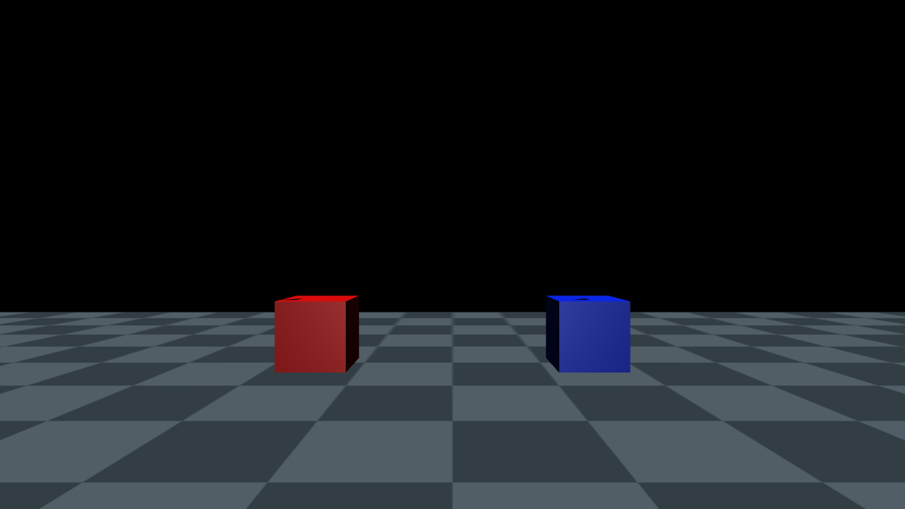
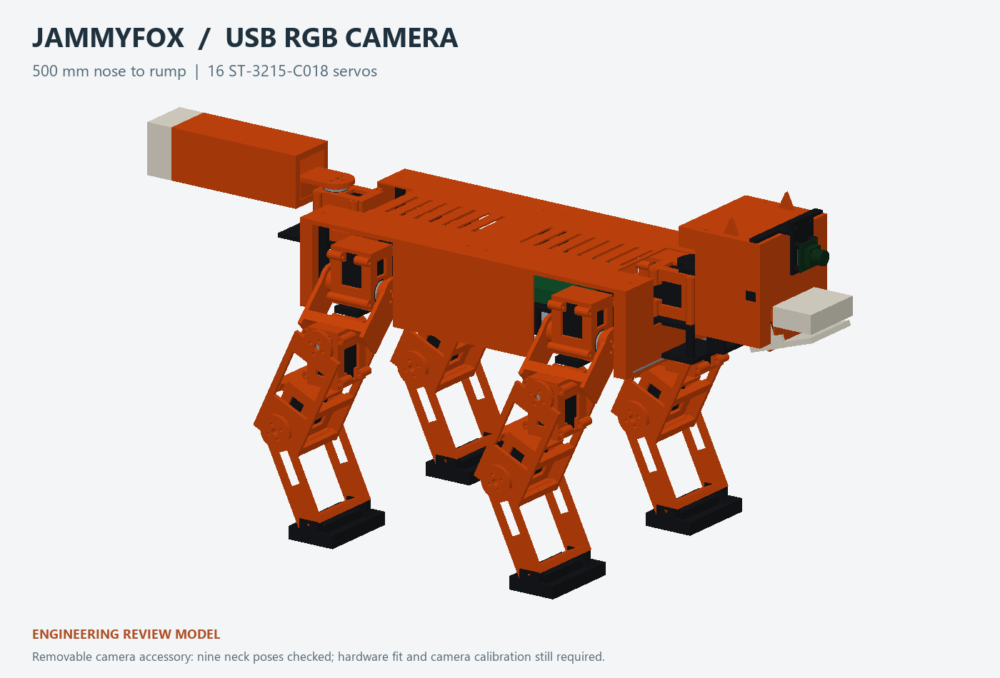

# JammyFox USB RGB camera — accessory revision 1

The camera accessory uses a **Waveshare OV4689 4MP USB Camera (A), SKU 34767**. It follows head yaw and pitch and uses the existing front head-lid screw positions. The two printed parts are removable; the existing head shell and lid are unchanged.

## Hardware and purchase references

The manufacturer specifies USB 2.0, 5 V, a 25 × 25 mm board, 1.6 mm PCB thickness, four Ø2 mm holes on a 21 mm square pattern, a Ø14 mm lens and 22.1 mm total depth. See the [product](https://www.waveshare.com/ov4689-4mp-usb-camera-a.htm), [documentation](https://docs.waveshare.com/OV4689-4MP-USB-Camera-A) and [dimension drawing](https://docs.waveshare.com/assets/images/OV4689-4MP-USB-Camera-A-details-size-423975adea0eff87fba3d5a4d27655e0.webp). Buy the exact A module; other OV4689 boards may have different mounting dimensions.

| Addition | Planning allowance (RMB) | Purchase reference |
|---|---:|---|
| OV4689 USB camera A, one | 200 | [JD search](https://search.jd.com/Search?keyword=%E5%BE%AE%E9%9B%AA%20OV4689%204MP%20USB%20Camera%20A%2034767&enc=utf-8) · [Taobao search](https://s.taobao.com/search?q=%E5%BE%AE%E9%9B%AA%20OV4689%204MP%20USB%20Camera%20A%2034767) |
| Small powered USB data hub, host adapter and short camera USB data cable | 50 | [JD search](https://search.jd.com/Search?keyword=USB%202.0%20%E8%87%AA%E4%BE%9B%E7%94%B5%20%E6%95%B0%E6%8D%AEHUB%205V%20Type-C&enc=utf-8) · [Taobao search](https://s.taobao.com/search?q=USB%202.0%20%E8%87%AA%E4%BE%9B%E7%94%B5%20%E6%95%B0%E6%8D%AEHUB%205V%20Type-C) |
| PLA, M2/M3 hardware and cable ties | 20 | [JD hardware search](https://search.jd.com/Search?keyword=M2%2012%20M3%2035%20M3%2012%20%E5%86%85%E5%85%AD%E8%A7%92%20%E8%9E%BA%E6%AF%8D&enc=utf-8) · [Taobao search](https://s.taobao.com/search?q=M2%2012%20M3%2035%20M3%2012%20%E5%86%85%E5%85%AD%E8%A7%92%20%E8%9E%BA%E6%AF%8D) |
| **Additional allowance** | **270** | Price, stock and exact package must be confirmed with the seller |

Adding this to the original ¥4,320 plan gives **¥4,590**, with the existing ¥400 reserve retained. This is a planning total, not a seller quotation.

## Connection

```text
USB RGB camera ─┐
               ├─ powered USB data hub ─ Radxa ZERO 3W USB host
ESP32 MCU ─────┘                              │
                                          Wi-Fi LAN
                                             │
                                      external Jetson
```

The [ZERO 3W product brief](https://dl.radxa.com/zero3/docs/hw/3w/radxa_zero_3w_product_brief.pdf) limits the host port to 500 mA. Use a powered data hub for the camera and MCU, with a suitable regulated 5 V supply and no backfeeding into the upstream host. Camera video and servo-command expiry remain separate concerns. The MCU continues local servo coordination if video is late or absent.

Start with 1280 × 720 at 15 fps, using MJPEG or another measured compressed stream over Wi-Fi. The camera supports that resolution. USB capture, power draw, exposure, minimum usable focus distance, image timestamps and Wi-Fi delay require testing on the actual MPU/camera. No physical camera or network stream has been tested yet.

## Printed parts and screws

- [camera_lid_bridge.stl](../stl/camera_lid_bridge.stl): top bridge and flange; two existing lid positions at x=282 mm, y=±44 mm.
- [camera_board_carrier.stl](../stl/camera_board_carrier.stl): camera carrier with four 5 mm standoffs and captive M2 nut pockets.
- [camera accessory plate](../printable/plates/14_usb_camera_addon.3mf): one of each part, in black PLA.

Use **two M3 × 35** bolts for the shared front lid/bridge positions, with four 0.5 mm M3 washers and two M3 locknuts. Use **two M3 × 12**, four M3 washers and two M3 locknuts between bridge and carrier. Use **four M2 × 12**, four M2 flat washers and four ordinary M2 hex nuts for the PCB. M2 nut pockets are 4.3 mm across flats and 1.8 mm deep; check against your actual nuts. These are nominal fit-trial lengths. The original cover attachment and nut-seat details retain their Rev A limitations.

The carrier is oriented with its broad rear face on the print bed; the bridge is oriented with its flat lid-contact face down. Trial 0.2 mm layers and 5 walls. Inspect the small bridges over nut pockets and horizontal M3 holes in Bambu Studio. Insert the M2 nuts before fastening the camera. Confirm screw tips clear the existing lid, PCB parts and cable connector. Route a loose USB service loop for the ±20° yaw and ±15° pitch ranges; the bridge has tie slots.

## CAD and simulation

- [Full STEP assembly with camera](../hardware/camera/JammyFox_USB_RGB_Camera.step) opens in SolidWorks.
- [Accessory STEP assembly](../hardware/camera/USB_Camera_Addon.step), individual STEP parts and the [FreeCAD assembly](../hardware/camera/JammyFox_USB_RGB_Camera.FCStd) are also supplied.
- [CAD source](../hardware/camera/build_camera_addon.py) runs with FreeCADCmd and uses the adjacent `camera_addon.json` and `RevA_reference.FCStd`; outputs go into `generated/`. The portable CAD runtime is supplied separately.
- [Camera model](../mjcf/jammyfox_camera.xml), [grasp fixture](../mjcf/jammyfox_grasp_camera.xml) and [visual demo](../mjcf/jammyfox_camera_demo.xml) preserve 16 actuators. The original camera-free XML files remain usable.
- `head_rgb` is fixed to `neck_pitch`, looking along the head's +X axis. Its nominal optical reference is CAD [322.6, 0, 305] mm; the true optical centre and intrinsics need calibration.

The vertical FOV is an estimate derived from the manufacturer's 92° diagonal FOV and a 16:9 pinhole model. USB sensor cropping, distortion and focus can change the effective FOV; this is not a calibrated camera model. The camera cannot see an object once it is hidden inside the mouth. Initial vision trials should use known objects on a stand near mouth height.

The added CAD mass estimate is **34.4 g**, including an assumed 25 g camera and solid PLA. Cables and screws are excluded. Nine neck-limit combinations and nominal CAD contact clearances were checked; physical fit, print strength and hardware operation remain unverified. [Validation report](../metadata/camera_validation.json).

## Run the live simulation view

```bash
conda activate jammyfox
cd ~/JammyFox
python scripts/preview.py --demo --camera head_rgb
```

The red and blue boxes are visual test markers, not a grasp-training scene. Drag `neck_yaw_servo` and `neck_pitch_servo`; the view moves with the head. To inspect the camera mount from outside, use `--camera overview` or select a camera in the viewer UI.

```bash
python scripts/capture_camera.py --demo
```

This saves a true RGB render to `reports/camera/head_rgb.png` at the configured resolution. It uses MuJoCo and NumPy with a standard-library PNG encoder; OpenCV is not required.

## Verified simulated view



The 1280 × 720 image was rendered in the WSL `jammyfox` environment. Red appears on the left and blue on the right; camera axes and head-motion coupling were checked.



## MPU-to-Jetson frame transport

`scripts/serve_camera.py` caches one latest JPEG; `/frame.jpg` returns it and `/health` reports capture status. Frames older than 0.5 seconds in the producer cache return HTTP 503. The receiver uses a direct LAN connection, so the Windows proxy configured in your shell does not redirect robot video requests.

For a local transport exercise in WSL, use two terminals:

```bash
# Terminal 1: replay the supplied static simulation JPEG
conda activate jammyfox
cd ~/JammyFox
python scripts/serve_camera.py --test-image docs/images/head_rgb_transport_demo.jpg
```

```bash
# Terminal 2: receive that JPEG
conda activate jammyfox
cd ~/JammyFox
python scripts/fetch_camera_frame.py http://127.0.0.1:8081/frame.jpg
```

After the USB camera arrives, run capture on the **onboard MPU**, where the camera is plugged in:

```bash
sudo apt install ffmpeg v4l-utils
v4l2-ctl --list-devices
v4l2-ctl --device /dev/video0 --list-formats-ext
python3 scripts/serve_camera.py --device /dev/video0 --fps 30 --bind 0.0.0.0
```

Confirm the actual device path and supported MJPEG mode before starting. The server copies MJPEG frames through [FFmpeg V4L2 capture](https://ffmpeg.org/ffmpeg-devices.html#video4linux2_002c-v4l2) and [multipart JPEG framing](https://ffmpeg.org/ffmpeg-formats.html#mpjpeg), avoiding image decoding or re-encoding on the MPU. Use a stable `/dev/v4l/by-id/` path if available.

On the Jetson, from a copy of this repository:

```bash
python3 scripts/fetch_camera_frame.py http://MPU_IP:8081/frame.jpg
```

Replace `MPU_IP` with the onboard MPU's Wi-Fi address. A vision program can import `fetch_frame()` to receive JPEG bytes and frame metadata, polling approximately 15 times per second. The script saves a JPEG and metadata JSON for inspection. This transport does not send servo commands.

`received_time_ns` marks arrival from the capture pipe, not sensor exposure. The receiver rejects frames when producer cache age plus request duration exceeds 500 ms; this bound does not include unknown camera/USB buffering. Measure actual camera-to-inference delay before using images for robot control. Local TCP transfer, frame parsing, stale-cache rejection and proxy bypass were tested. Actual USB capture, Wi-Fi performance and Jetson inference remain hardware tests.
